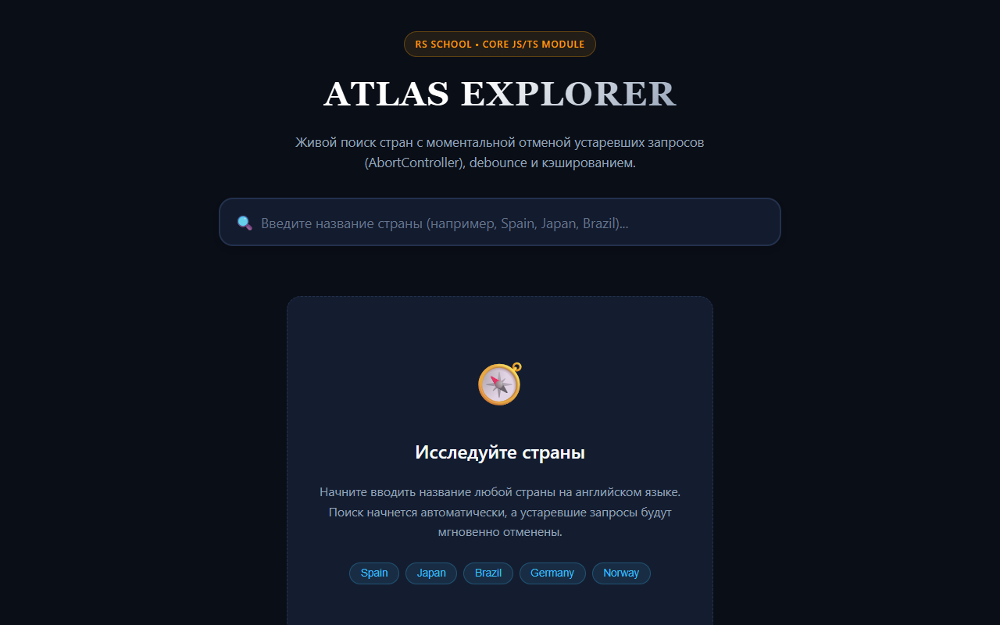

# Pull Request: Country Search

## 🔗 Ссылки

- **Задание**: [RS School — Country Search](https://github.com/rolling-scopes-school/tasks/blob/master/fullstack-engineering/tasks/country-search/README.md)
- **Деплой**: [https://khamzadobriev.github.io/country-search/](https://khamzadobriev.github.io/country-search/) _(после слияния/деплоя ветки в GitHub Pages)_
- **Архитектурная документация**: [DESIGN.md](./DESIGN.md)

---

## 📸 Скриншот интерфейса

---

## 🛠 Выполненный функционал

### 1. Архитектура отмены и защита от гонки запросов (Race Condition)

- **`debounce(fn, delay)`**: собственная реализация без сторонних библиотек, с поддержкой типизации и метода `.cancel()`. Задержка — 350 мс.
- **`searchCountries(query, signal, options)`**: обертка над Fetch API с проверкой `response.ok`, обработкой статуса 404 как пустого массива (без ошибки) и генерацией `HttpError` для остальных кодов. Поддерживает таймаут (10 сек) через связку с `DOMException('TimeoutError')`.
- **`HttpError`**: кастомный класс ошибки с сохранением HTTP-статуса.
- **`classifyError(error)`**: разделяет `AbortError` (подавляется, не тревожит пользователя), `TimeoutError`, `HttpError`, сетевые сбои `TypeError` и неизвестные ошибки.
- **Немедленная отмена в `SearchCoordinator`**: при любом изменении строки поиска (`onInput`) предыдущий активный запрос отменяется **мгновенно** через `AbortController.abort()`, не дожидаясь срабатывания таймера debounce.
- **Тест на гонку ответов (`tests/raceCondition.test.ts`)**: мок `fetch` с инверсией порядка резолва подтверждает, что при наборе нового текста старый запрос прерывается, а задержанный ответ не перезаписывает актуальные данные.

### 2. Бонусный функционал (+10 баллов)

- **Кэш запросов и дедупликация (`SearchCache`) (+6 баллов)**:
  - Повторный поиск по той же строке берется из LRU-кэша без сетевых вызовов.
  - Параллельные одинаковые запросы дедуплицируются в один in-flight Promise.
  - Каждый вызывающий имеет независимый `AbortSignal`: отмена одного не срывает выполнение для остальных.
- **История поиска (`SearchHistory`) (+4 балла)**:
  - Сохранение последних 5 уникальных запросов в `localStorage`.
  - Интерактивные чипсы под строкой поиска с мгновенным повторным поиском по клику и возможностью удаления.

### 3. Пользовательский интерфейс и дизайн

- Чистый, выразительный интерфейс в картографическом стиле: гармоничная темная палитра, контрастная типографика, плавные микровзаимодействия.
- Полная семантика состояний:
  - **Начальное (IDLE)**: карточка с быстрыми подсказками (Spain, Japan, Brazil...).
  - **Загрузка (LOADING)**: скелетоны с шиммер-анимацией и спиннер в поле ввода.
  - **Пусто (EMPTY / 404)**: дружелюбный информативный блок без признаков ошибки.
  - **Ошибка (ERROR)**: понятное описание проблемы и кнопка «Повторить запрос», повторяющая именно последний введенный запрос.
  - **Результаты (SUCCESS)**: адаптивная сетка карточек с флагом, названием, столицей, регионом и населением.
  - **Детальный модальный просмотр**: по клику на карточку открывается подробная информация (официальное название, площадь, валюты, языки, сухопутные границы, часовые пояса, телефонные коды) с поддержкой закрытия по Esc, клику вне окна и клавиатурной навигации.
- **Безопасность**: 100% отказ от `innerHTML` и `insertAdjacentHTML` для динамического контента — все элементы строятся через безопасные браузерные DOM API.

---

## 🧪 TDD и подтверждение порядка коммитов

Каждая функция разработана строго по методологии TDD (FIRST): сначала коммит с падающими тестами (RED), затем коммит с реализацией (GREEN).

1. `debounce`:
   - `89f3d8a test(core): add tests for debounce`
   - `35f529b feat(core): implement debounce`
2. `searchCountries` + `HttpError`:
   - `1d2a8fd test(api): add tests for searchCountries`
   - `f97e442 feat(api): implement searchCountries and HttpError`
3. `mapCountryResponse`:
   - `4e80e39 test(core): add tests for mapCountryResponse`
   - `e6cc142 feat(core): implement mapCountryResponse`
4. `classifyError`:
   - `349ed00 test(core): add tests for classifyError`
   - `123d502 feat(core): implement classifyError`
5. `searchCache` (бонус):
   - `b0c5bce test(cache): add tests for searchCache`
   - `7f2a41d feat(cache): implement searchCache with request deduplication`
6. `searchHistory` (бонус):
   - `870dbfe test(storage): add tests for searchHistory`
   - `a4ff345 feat(storage): implement searchHistory`
7. Гонка запросов и SearchCoordinator:
   - `79c34d3 test(core): add test for request race condition cancellation`
   - `aaf755c feat(core): implement SearchCoordinator with cancellation and race condition prevention`
   - `aadf6ab test(core): add unit tests for SearchCoordinator`

---

## ✅ Чек-лист самопроверки

- [x] Пустой ввод — запросов нет, список пуст (или в начальном состоянии)
- [x] Во время запроса виден индикатор загрузки
- [x] Быстрый набор не приводит к отображению результатов устаревшего запроса
- [x] В Network tab отменённые запросы помечаются как `canceled`/`aborted`
- [x] Отмена своего же запроса не показывается пользователю как ошибка
- [x] Запрос без совпадений (404) показывает дружелюбное «ничего не найдено», не похожее на ошибку
- [x] Реальная ошибка показывает сообщение с кнопкой «Повторить», повтор отправляет именно последний введённый запрос
- [x] Клик по карточке открывает детальный вид
- [x] Порядок коммитов TDD соблюден для всех компонентов
- [x] Husky pre-commit запускает lint-staged, pre-push запускает npm test
- [x] Документация `DESIGN.md` полностью заполнена

## 📊 Оценка

- **Базовая часть**: 145 / 145 баллов
- **Бонус**: 10 / 10 баллов (кэш +6, история +4)
- **Итого**: 155 / 155 баллов
